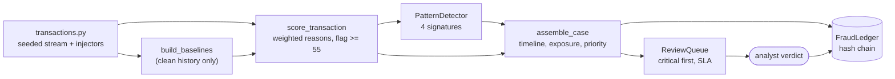

# Jagadish-fraud-detection-agents

[](https://github.com/jagadishmazure-jpg/Jagadish-fraud-detection-agents/actions/workflows/ci.yml)
[](https://github.com/jagadishmazure-jpg/Jagadish-fraud-detection-agents/actions/workflows/codeql.yml)


**Financial fraud detection from transaction stream to analyst verdict: explainable scoring, four signature detectors, evidence-cited cases and a prioritised review queue.**

> Personal learning and portfolio project. Everything runs offline on synthetic,
> fictional data with no API keys. Nothing is deployed. Numbers in this README
> come from real runs and are re-checked by CI (`scripts/render_docs.py --check`).

## Recruiter summary

- End-to-end fraud operations pipeline on a seeded synthetic bank: baselines, per-transaction risk scoring with reasons, pattern detectors, case assembly, SLA-tracked queue, hash-chained ledger.
- Measured on the seeded demo: 4 of 4 injected patterns detected, 0 false positives on 8 clean accounts, and an honest gap (card testing is caught by the pattern layer, not the per-transaction score).
- Pure Python, deterministic, offline tests; CI with lint, CodeQL, gitleaks and documented-output drift checks.

## Purpose

Fraud teams rarely lack alerts; they lack time. The expensive part is turning a
raw alert into a decision. This repo models that whole path for a fictional bank:
every flag carries its reasons, flags roll up into evidence-cited cases, and cases
land in a queue ordered by severity and exposure, with every step on a
tamper-evident ledger. A human analyst records the verdict.

## Architecture



## How it works

Two layers look at the same stream:

1. **Per-transaction scoring** (`fraud/detect.py::score_transaction`) compares
   each transaction with the account's clean-history baseline. Velocity (30),
   amount z-score (30), new geo/device (25) and channel risk add up to a score;
   55 or more flags it. Each point comes with a sentence of reason.
2. **Pattern detectors** look at windows of an account's history:

| Pattern | Signature | Severity |
|---|---|---|
| Card testing | 10 or more sub-$5 e-commerce authorisations in 30 minutes | high |
| Account takeover | a probe of $2 or less from a new device and geo, then 4+ purchases of $200+ within 6 hours | critical |
| Money mule | credits from 3+ counterparties, then 70%+ withdrawn at ATMs within 24 hours | critical |
| Merchant collusion | 6+ identical round-dollar charges at one merchant in 7 days | medium |

Cases combine both layers, compute exposure, and get a priority. The queue sorts
critical first, tracks SLA hours, and records assignment and verdict. Baselines
are built from clean history only, so injected fraud cannot teach the model that
fraud is normal. Detail: [docs/fraud-patterns.md](docs/fraud-patterns.md).

## Real code and output

```python
"""Inject four fraud patterns into a synthetic stream, then detect, score, case and queue them (offline)."""
from fraud import (
    FraudCase,
    PatternDetector,
    ReviewQueue,
    assemble_case,
    build_baselines,
    gen_transactions,
    inject_account_takeover,
    inject_card_testing,
    inject_merchant_collusion,
    inject_money_mule,
    score_transaction,
)

FraudCase._seq = 0
clean = gen_transactions(n_accounts=12, days=30, seed=42)
injected = {"acct-001": "card_testing", "acct-004": "account_takeover",
            "acct-007": "money_mule", "acct-010": "merchant_collusion"}
txns = inject_card_testing(clean, "acct-001", n=18, seed=7)
txns = inject_account_takeover(txns, "acct-004", seed=11)
txns = inject_money_mule(txns, "acct-007", seed=13)
txns = inject_merchant_collusion(txns, "acct-010", seed=17)
baselines = build_baselines(clean)          # baselines come from clean history only

by_acct = {}
for t in txns:
    by_acct.setdefault(t["account_id"], []).append(t)
scored = {t["txn_id"]: score_transaction(t, baselines[t["account_id"]], by_acct[t["account_id"]]) for t in txns}
detector = PatternDetector(txns, scored)
queue = ReviewQueue()

print(f"{len(txns)} transactions, {len(by_acct)} accounts, {len(injected)} accounts with an injected pattern\n")
tp = fp = fn = 0
for acct in sorted(by_acct):
    patterns = detector.detect_all(acct, baselines[acct])
    names = [p["pattern"] for p in patterns]
    expected = injected.get(acct)
    tp += expected in names
    fn += expected is not None and expected not in names
    fp += len([n for n in names if n != expected])
    case = assemble_case(acct, patterns, [scored[t["txn_id"]] for t in by_acct[acct]], by_acct[acct], txns)
    if case:
        queue.add(case)
    flagged = sum(scored[t["txn_id"]]["flagged"] for t in by_acct[acct])
    print(f"{acct}  injected={expected or '-':18} detected={','.join(names) or '-':18} flagged_txns={flagged}")

print(f"\nPattern detection: {tp} true positives, {fp} false positives, {fn} missed")
print("\nAnalyst worklist (critical first):")
for row in queue.worklist():
    print(f"  {row['case_id']}  {row['account_id']}  {row['priority']:8}  exposure=${row['exposure']:,.2f}")
```

Output of `python examples/demo.py` (real run, re-checked in CI):

<!-- run: python examples/demo.py -->
```text
1687 transactions, 12 accounts, 4 accounts with an injected pattern

acct-001  injected=card_testing       detected=card_testing       flagged_txns=0
acct-002  injected=-                  detected=-                  flagged_txns=0
acct-003  injected=-                  detected=-                  flagged_txns=0
acct-004  injected=account_takeover   detected=account_takeover   flagged_txns=9
acct-005  injected=-                  detected=-                  flagged_txns=0
acct-006  injected=-                  detected=-                  flagged_txns=0
acct-007  injected=money_mule         detected=money_mule         flagged_txns=8
acct-008  injected=-                  detected=-                  flagged_txns=0
acct-009  injected=-                  detected=-                  flagged_txns=0
acct-010  injected=merchant_collusion detected=merchant_collusion flagged_txns=0
acct-011  injected=-                  detected=-                  flagged_txns=0
acct-012  injected=-                  detected=-                  flagged_txns=0

Pattern detection: 4 true positives, 0 false positives, 0 missed

Analyst worklist (critical first):
  CASE-0002  acct-004  critical  exposure=$7,333.68
  CASE-0003  acct-007  critical  exposure=$7,205.77
  CASE-0001  acct-001  high      exposure=$30.43
  CASE-0004  acct-010  high      exposure=$2,000.00
```
<!-- /run -->

## How to run

```bash
git clone https://github.com/jagadishmazure-jpg/Jagadish-fraud-detection-agents.git
cd Jagadish-fraud-detection-agents
python -m pip install pytest      # no runtime dependencies
python -m pytest -q          # offline, no keys
python examples/demo.py
python scripts/render_docs.py --check   # documented output still matches
```

Test suite size (real collection, re-checked in CI):

<!-- run: python scripts/count_tests.py -->
```text
35 tests collected
```
<!-- /run -->

## Guardrails

- Every flag and pattern carries human-readable evidence; nothing is a bare number.
- The system never blocks or closes an account: it opens cases, and an analyst records the verdict.
- Baselines come from clean history only, so attacked data cannot shift what normal looks like.
- Every detection, case, assignment and verdict is written to a hash-chained ledger that can be verified.
- Synthetic accounts and merchants only; no real card or customer data.

## Limitations

- The 4/4 detection result is on patterns this repo injects itself; it is a correctness check, not a real-world detection rate.
- Card-testing probes score at most 50.5 per transaction, below the 55 flag threshold; only the pattern detector catches them.
- Thresholds and weights are hand-set, not trained or calibrated on labelled data.
- Everything runs in memory on one machine; no streaming infrastructure.

## Built vs planned

| Capability | Status | Where |
|---|---|---|
| Seeded transaction generator and four pattern injectors | Built | `fraud/transactions.py` |
| Explainable per-transaction scoring | Built | `fraud/detect.py` |
| Four signature detectors | Built | `fraud/detect.py::PatternDetector` |
| Case assembly, priority, review queue with SLA | Built | `fraud/cases.py`, `fraud/queue.py` |
| Hash-chained audit ledger | Built | `fraud/audit.py` |
| Precision/recall on a large labelled synthetic set | Planned | not started |
| Streaming ingestion (Event Hubs) and ML scorer | Planned | docs/implementation-guide.md |
| Case-management UI | Planned | not started |

## Implementation guide

The step-by-step path from this offline build to an Azure deployment is in
[docs/implementation-guide.md](docs/implementation-guide.md). None of it has been
run; it is a plan.

## Related repositories

| Repo | How it relates |
|---|---|
| [Jagadish-agentic-ai-model-risk](https://github.com/jagadishmazure-jpg/Jagadish-agentic-ai-model-risk) | Model cards, validation and monitoring for a fraud model like this one |
| [Jagadish-insurance-claims-agents](https://github.com/jagadishmazure-jpg/Jagadish-insurance-claims-agents) | Claims-side fraud signals with the same evidence-first, human-decides shape |
| [Jagadish-azure-ai-soc](https://github.com/jagadishmazure-jpg/Jagadish-azure-ai-soc) | Same triage, queue and SLA ideas applied to security alerts |
| [Jagadish-agentic-data-layer](https://github.com/jagadishmazure-jpg/Jagadish-agentic-data-layer) | Governed data products a production scorer would read from |

## Documentation

- [Fraud patterns](docs/fraud-patterns.md)
- [Implementation guide (Azure)](docs/implementation-guide.md)
- [Interview points](docs/interview-points.md)
- [Security policy](SECURITY.md)

## Project layout

```
fraud/
  transactions.py  seeded multi-account stream + 4 pattern injectors
  detect.py        baselines, per-transaction scoring, PatternDetector
  cases.py         case assembly, exposure, priority
  queue.py         analyst worklist, assignment, verdict, SLA
  audit.py         hash-chained ledger
examples/demo.py   the run shown above
tests/             offline pytest suite
```

## License

MIT, see [LICENSE](LICENSE). All data is synthetic; every organisation and person is fictional.
